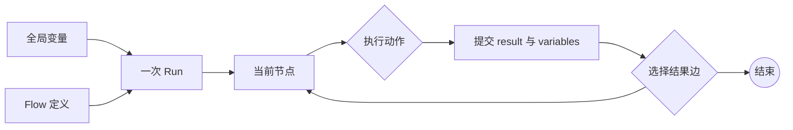

# Agent Flow Runtime 总体设计

## 1. 定位

Agent Flow Runtime 把一次具体目标交给可复用 Flow，并按节点、结果边和变量作用域推动执行。Flow 定义路径，Run 保存一次执行状态，NodeRun 保存一次节点访问。

```text
目标变量   本次 Run 的全局输入
Flow      可复用工作路径
Run       一次执行实例
NodeRun   一次节点访问记录
```

Flow 不保存运行状态，Run 不修改 Flow，NodeRun 不代表新的 Flow 节点。

## 2. 执行模型



启动时校验并建立全局变量快照。每次进入节点：

1. 创建 NodeRun。
2. 渲染当前节点的 `{var.xxx}`、`{input.xxx}`，并在汇合节点渲染 `{branch.<引用>.<变量>}`。
3. 执行一个 Agent、命令或子 Flow 动作。
4. 校验 `result` 和声明的 `variables`。
5. 原子保存全局变量更新、下一跳输入和路由结果。

`result` 只负责选择结果边。元信息声明的变量写入全局状态，结果说明中声明的其他变量只传给下一节点。未声明变量拒绝提交。

## 3. 并行与子 Flow

并行开始点保存输入快照，各命令分支读取同一轮输入。分支变量按分支引用隔离，汇合节点通过 `{branch.<分支引用>.<变量>}`读取，汇合结果成为下一节点的 `input`。新一轮并行不读取历史轮次。

`执行Flow`使用显式 `inputs` 启动独立子 Run：

```json
{
  "flow": "security-check",
  "inputs": { "项目": "{var.项目}" }
}
```

子 Flow 使用自己的全局变量。内部变量不会自动回传，父节点只通过自身结果说明产生下一跳变量。子 Run 有独立事实和 Agent 绑定，只随父 Run 恢复。

## 4. 模块职责

### Flow 解析器

读取 Markdown，生成结构合法的 `FlowDefinition`，校验图、动作、变量声明、引用和资源，不执行动作。

### FlowCoordinator

作为一次 Run 的状态唯一写入者，负责创建 NodeRun、渲染变量、执行动作、校验结果、选择路由、管理并行轮次和父子 Run。

### AgentRunModel

按 Run 管理 Agent 绑定，处理新建、复用、接管和释放，返回统一节点结果与会话引用。

### AgentIntegrationAdapter

接入具体 Agent 平台，负责会话、提示注入、结果工具和交互读取。不读取 Flow 图，不选择结果边，不修改 Run。

### CommandExecutor

执行命令，返回 `commandResult` 执行证据。只有命令声明 `output: "variables"` 时，标准输出中的 `variables` 信封才进入业务变量。

### RunStore

保存 Run、NodeRun、变量快照、下一跳输入、并行轮次和父子关联，不参与流程解释和路由。

## 5. 运行记录与恢复

Run 记录当前状态、全局变量和当前位置。NodeRun 记录当前节点输入、`result`、变量、耗时、错误和执行依据。恢复必须使用与原 Run 相同的 Flow 组合版本。

子 Run 记录 `parentRunId` 和 `parentNodeRunId`，父 NodeRun 记录 `childRunId`。子 Run 终态与父节点完成是两个事实提交，恢复逻辑必须覆盖两次提交之间的崩溃窗口。

## 6. 必须保持的规则

- Flow 是工作方法，Run 是执行实例，NodeRun 是访问历史。
- 全局变量使用 `{var.xxx}`，上一节点输出使用 `{input.xxx}`，分支输出使用 `{branch.<引用>.<变量>}`。
- `result` 只路由，变量显式声明并按作用域传递。
- 只有协调器可以改变 Run 状态和流程位置。
- Agent 只能通过受校验的结果提交回到运行时。
- 并行分支和汇合结果属于同一轮次。
- 子 Flow 只接收显式输入，内部状态不自动回传。
- 观测只读取执行事实，不替流程选择路径。

## 7. MVP

MVP 包含 Markdown Flow 解析、全局变量启动、`var/input/branch` 引用、三种 Agent/命令动作、单层命令并行、显式汇合、子 Flow、Agent 会话关联和 NodeRun 记录。详细格式见[Flow 规范](flow-spec.md)，模块边界见[架构设计](agent-flow-runtime-architecture.md)。
