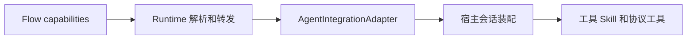

# Agent 能力声明

## 定位

Flow 负责声明本 Flow 中 Agent 可以使用的业务工具和 Skill。Runtime 只校验、保存和转发这份声明，并管理 Agent 会话和 Flow 状态。宿主适配器把逻辑名称转换为实际会话能力。

未声明 `capabilities` 时，工具和 Skill 都是空集合。Runtime 协议工具 `submit_flow_outcome` 由宿主始终注入，它负责提交当前节点结果，不属于 Flow 的业务能力。

## 声明格式

```yaml
capabilities:
  tools:
    - read
    - grep
  skills:
    - code-review
```

`tools` 和 `skills` 都是字符串数组，缺省时归一为空数组。每项必须是非空字符串，同一数组不能重复，`capabilities` 不能包含其他字段。首版能力声明属于整个 Flow，同一 Flow 的所有 Agent 节点使用同一份声明。

能力名称是逻辑名称。Flow 不携带工具实现、Skill 正文、宿主对象或权限配置。

## 分层职责



Runtime 负责：

- 解析和规范化 Flow 能力声明。
- 将声明纳入 Flow fingerprint，防止旧能力配置被静默恢复。
- 在新建或接管 Agent 时把声明传给适配器。
- 保持 Flow 路由、变量、恢复和 Agent 生命周期语义独立。

通用 Agent 契约负责：

- 创建或接管会话时接收能力声明。
- 执行节点任务并接收结构化结果。
- 让 `新建Agent` 创建新的能力固定会话。
- 让 `复用Agent` 沿用当前绑定的会话能力，不重新装配能力。

宿主适配器负责：

- 验证宿主是否提供每个声明的工具和 Skill。
- 在会话创建时启用声明的能力。
- 禁止未声明的业务工具和 Skill 进入最小 Agent。
- 对无法隔离或能力缺失直接报错，不通过提示词模拟权限。

## 生命周期规则

- 未声明能力的 Agent 只有空业务能力和 `submit_flow_outcome`。
- `新建Agent` 会释放当前绑定并按 Flow 声明创建新会话。
- `复用Agent` 只使用当前绑定，不增加或切换能力。
- 能力切换必须再次执行 `新建Agent`。
- 子 Flow 使用自己的 `capabilities`，不继承父 Flow 的 Agent 或能力。
- Flow 能力变化会改变 fingerprint。完整历史恢复时，能力变化会导致版本不匹配。
- 宿主无法提供声明能力时，创建或接管会话失败。

## Pi 实现

Pi SDK 适配器使用显式工具 allowlist，并通过隔离的 `DefaultResourceLoader` 只保留声明的 Skill，同时关闭扩展、上下文文件、提示模板和主题的默认发现。创建后还会检查实际启用的工具集合。

当前 Pi CLI 扩展使用宿主已经创建的会话。该路径无法在 Flow 运行时重新配置工具和 Skill，因此适配器会明确拒绝 CLI Agent 的创建和接管，避免继承当前会话能力。

## 代码映射

- `src/types.ts#AgentCapabilityDeclaration`：能力声明和通用适配器契约。
- `src/agent-capabilities.ts`：默认空能力、规范化和声明校验。
- `src/parser.ts#parseMetadata`：解析 Flow 元信息。
- `src/agent.ts#AgentRunModel`：维护 Run 级 Agent 绑定。
- `src/runtime.ts#fingerprintFlow`：把能力声明纳入恢复版本。
- `src/pi.ts#PiAgentIntegrationAdapter`：Pi SDK 能力装配和 CLI 隔离失败。

首版不建立 Profile、能力注册表、Provider 体系、通用插件总线或节点级能力映射。若未来需要节点使用不同能力，再单独扩展 Agent 节点契约。
