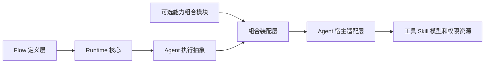

# Agent 能力组合

## 定位

Agent 能力是 Flow 的可选执行能力，不属于 Flow Runtime 的核心领域。Flow Runtime 负责“流程如何推进”，能力模块负责“执行 Agent 具备什么能力”，宿主适配器负责“如何在具体平台中装配这些能力”。

能力模块可以完全不安装。没有能力模块时，Runtime 继续通过 `AgentIntegrationAdapter` 使用宿主提供的默认 Agent 行为。

## 分层

### Flow 定义层

Flow 描述节点、结果、路由、变量和控制流。可选能力模块可以声明某个节点需要的逻辑能力，但不直接携带宿主对象、工具实现、Skill 正文或权限开关。

能力声明由所属模块解释。Runtime 核心不需要识别所有模块的扩展数据，也不因为能力模块不存在而改变普通 Flow 的语义。

### Runtime 核心

Runtime 核心负责：

- Flow 节点执行和结果路由。
- Run、NodeRun、ParallelRound 和恢复事实。
- Agent 节点的通用执行协议。
- Agent 结果的结构化校验。
- 通过 `AgentIntegrationAdapter` 调用外部 Agent 宿主。

Runtime 核心不负责工具、Skill、模型、权限和 Profile。Agent 能力不能改变结果边、变量作用域或 Run 生命周期。

### Agent 能力组合模块

能力模块负责解析逻辑能力，组合工具、Skill、模型和权限策略，并把解析结果交给宿主装配。它不创建 Flow 节点，不拥有路由状态，不创建子 Run，也不替代 Runtime 的恢复逻辑。

能力模块可以由多个独立能力提供者组成。组合发生在宿主装配阶段，不通过嵌套 Flow 表达。

### Agent 宿主适配层

宿主适配层把能力模块的结果转换为具体平台的会话配置。Pi SDK、Pi CLI 或其他 Agent 平台可以有不同的能力支持范围。宿主适配层应明确报告不支持的能力，不应通过提示词伪装成权限隔离。

## 组合规则

- Runtime 可以在没有能力模块时独立运行。
- 能力模块依赖 Runtime 的 Agent 抽象，Runtime 不依赖能力模块。
- 宿主适配器不决定 Flow 路由，只负责执行节点并返回结构化结果。
- Profile 或逻辑能力不是 Flow 节点，不产生结果边，不创建独立 Run。
- `执行Flow` 只用于控制流拆分。子 Flow 的能力配置与父 Flow 的控制流保持独立。
- `复用Agent` 继续当前 Agent 会话的能力上下文。能力切换必须由新的 Agent 会话承载。

## 状态归属

Runtime 持有 Run、NodeRun、路线和变量事实。能力模块持有能力解析结果、版本或摘要以及恢复所需的能力绑定信息。宿主持有具体会话和平台资源。

工具实现、Skill 内容、凭据和宿主对象不写入 Runtime 的核心事实。能力发生变化时，能力模块负责在恢复前验证兼容性，并明确拒绝不兼容的恢复。

## 当前代码映射

- `src/runtime.ts#FlowCoordinator`：Runtime 核心。
- `src/agent.ts#AgentRunModel`：通用 Agent 运行模型。
- `src/types.ts#AgentIntegrationAdapter`：Runtime 与 Agent 宿主之间的组合端口。
- `src/pi.ts#PiAgentIntegrationAdapter`：Pi 宿主适配器。
- `src/extension.ts#flowExtension`：Pi CLI 装配入口。

后续能力模块应在这些端口之外实现，不应把 Profile、工具和 Skill 语义加入 `FlowCoordinator` 或核心 Flow 类型。