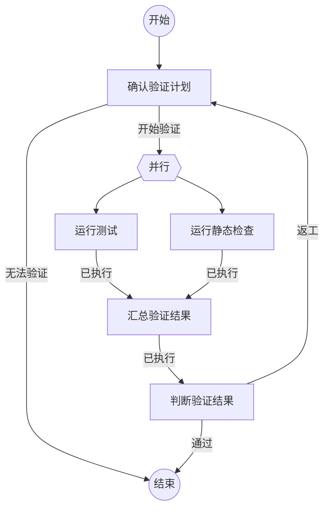

# Flow 规范

本规范定义可运行 Flow 文件的格式。Flow 的用途和整体方式见[Flow 概览](flow-overview.md)。

每条可执行 Flow 都是一个目录包。使用`--flow`或`/flow run`时，只能传入包目录或包内的`FLOW.md`；运行时直接执行该入口，不生成运行副本。

## Flow 包目录

目录约定参考 Skill：一个目录只有一个固定入口，其余文件按用途放在入口旁边。即使暂时不需要参考资料或脚本，也必须使用包目录。

```text
.flows/
└── release-check/
    ├── FLOW.md
    ├── references/
    │   └── release-checklist.md
    └── scripts/
        └── verify-version.mjs
```

规则只有四条：

1. `FLOW.md`是唯一入口，包目录名是 Flow 标识。例如`release-check/FLOW.md`的标识为`release-check`。
2. `FLOW.md`使用 Flow 图、节点、`name`、`description`和可选的 `variables`、`capabilities` 元信息，不增加目录格式专用字段。
3. `references/`只放供 Agent 阅读的 Markdown。入口中用普通相对链接引用它，例如`[发布检查清单](references/release-checklist.md)`。
4. `scripts/`只放命令节点调用的 Node.js ESM 脚本。命令参数从包根写相对路径，例如`"args": ["scripts/verify-version.mjs"]`。

除上述约定外，包内其他文件暂不定义运行时含义。Flow 作者可以按维护需要增加测试或说明文件，但不应让它们参与流程执行。

脚本文件属于 Flow 包，业务项目文件属于一次 Run 的工作目录。运行时会把标准 Markdown 内联链接中的`references/...`和命令`args`中独立的`scripts/...`定位到包内对应文件，命令进程的`cwd`仍保持业务项目目录。裸文本、引用式 Markdown 链接、复合命令参数和其他相对路径保持原样。

脚本需要读取业务项目时使用进程`cwd`，需要读取同包模块时使用 ESM 相对导入或`import.meta.url`。Flow 文件中不写机器相关的绝对路径。被引用的`references/...`必须是`.md`文件，被调用的`scripts/...`必须是`.mjs`文件；路径不能包含`.`或`..`段。

包目录名是 Flow 标识。例如`release-check/FLOW.md`的标识为`release-check`。`FlowDirectory`递归发现包目录，并跳过`references/`和`scripts/`资源目录。恢复运行会重新读取已记录的真实入口路径，因此仍使用原`FLOW.md`和同一包根。

一个节点还可以引用另一个 Flow 作为子 Run 执行。被引用方与引用方同处一级目录，即互为兄弟包：

```text
.flows/
├── release/
│   └── FLOW.md        # 含「执行Flow release-check」节点
└── release-check/
    ├── FLOW.md
    ├── references/
    └── scripts/
```

引用解析根是引用包根的上一级目录：`执行Flow`按标识定位`<上一级>/<flow>/FLOW.md`，只能指向兄弟包。加载引用方时会递归加载全部被引用 Flow 及其资源并校验，形成闭包；加载栈中出现重复标识（含自引用）即在加载期报错。语义细节见[5.1 引用执行](#51-引用执行)。

## 1. 文件开头

文件以元信息开头，包含流程名称、适用情况和可选的全局变量、Agent 能力声明：

```markdown
---
name: 代码修改与验证
description: 适用于目标明确、需要完成代码修改并运行测试验证的任务。
variables:
  任务:
    description: 本次代码修改目标
  项目:
    description: 目标项目
  检查范围:
    description: 本次检查范围
    default: 全部
capabilities:
  tools:
    - read
    - grep
  skills:
    - code-review
---
```

`name`和`description`均为非空内容。全局变量必须通过 `variables` 声明，每项必须有非空 `description`，可带 JSON 值 `default`。启动参数只能提供已声明变量，有默认值可省略，无默认值必须提供。`capabilities` 可声明 `tools` 和 `skills` 两个字符串数组，缺省时两者均为空；每项必须是非空字符串且不能在同一数组重复。能力名称由宿主解释，Flow 不携带工具实现或 Skill 正文。`submit_flow_outcome` 是 Runtime 协议工具，始终由 Agent 宿主提供，不写入业务能力声明。节点可以覆盖全局变量，不能新增未声明变量。结果变量表不能与全局变量同名。`name`供人展示，`description`供 Flow 目录和 Agent 发现、选择与复用 Flow。Flow 标识始终取`FLOW.md`父目录名。

### 宿主启动输入

Pi 宿主的自由文本输入作为全局变量`任务`传入：

```bash
pi --flow ./.flows/release-check -p "执行发布检查"
```

需要读取任务的 Flow 必须声明`任务`并使用`{var.任务}`。结构化输入使用`--var name=value`或`--variables <json文件>`；后者先加载，前者覆盖同名值。自由文本不能与另一个`任务`输入同时提供。所有输入变量都必须声明，SDK 则直接传入`run({ variables: {...} })`。

## 2. 图与节点

文件恰有一张`flowchart TD`。

- 开始固定写为`start((开始))`，只有一条去向。
- 结束固定写为`finish((结束))`，不再连向其他节点。
- 工作节点写为`节点引用名[节点名称]`。节点引用名和节点名称在同一 Flow 中唯一，节点名称与同名二级标题对应。
- 并行开始点写为`引用名{{并行}}`。它只控制图中的流转，不对应二级标题或动作。
- 工作节点的结果边写为`节点引用名 -->|结果名| 下一节点`。
- 并行开始点的出边省略结果文字，表示同时启动多个分支。

例如：



`plan[确认验证计划]`对应`## 确认验证计划`。`plan`用于连线和记录，节点名称直接表达当前工作。

每条工作节点的结果边在所属节点下都有一个同名三级标题。结果名只在发出它的节点内唯一，解释器以“节点引用名 + 结果名”查找下一节点。

只有一个结果边的工作节点实现固定流转。Agent 节点可以声明多个结果边，用于门禁和循环。

## 3. 节点动作

节点的动作区位于二级标题之后、第一个三级结果标题之前。一个动作区只包含一个非空动作代码块。

Agent 节点的提示词只由三部分组成：动作代码块内容（替换变量引用和资源链接后）、该节点各结果的三级标题说明、以及要求调用结果提交工具的固定指令。除此之外的内容一律不进入提示词：动作区内代码块之外的文字、二级标题之外的散落正文、元信息和 Mermaid 图都不参与提示词渲染，其中 Mermaid 图只用于解析图结构。

动作代码块使用以下标记：

- `新建Agent`：创建一个 Agent，并将它绑定到本次 Flow 运行。
- `复用Agent`：继续本次 Flow 运行已绑定的 Agent。
- `执行自定义命令`：执行代码块中的 JSON 命令请求。
- `执行Flow`：把输入交给另一个 Flow，作为一次独立子 Run 运行到终态。

Agent 动作的代码块内容是引导提示。自定义命令的代码块必须是一个 JSON 对象：

```json
{
  "command": "node",
  "args": ["scripts/check.mjs"],
  "stdin": { "task": "{var.任务}" },
  "output": "variables"
}
```

`command`是当前执行环境中的命令名或路径。`args`是可选的字符串数组。`stdin`是可选的 JSON 值，运行模型以 UTF-8 JSON 写入命令的标准输入。目录包中独立的`scripts/...`参数从包根定位，其他参数沿用原值。命令进程的工作目录是本次 Flow 运行指定的`cwd`；未指定时继承宿主进程的工作目录。

````markdown
## 确认验证计划

```新建Agent
根据以下任务建立实现契约：
{var.任务}
```

### 开始验证

已经具备运行验证所需的条件。

### 无法验证

缺少会影响验证方向的关键信息。
````

## 4. 输入与结果引用

一次 Flow 运行通过已声明的全局变量启动。节点提示词和命令模板使用 `{var.xxx}` 读取全局变量，使用 `{input.xxx}` 读取上一节点声明的下一跳变量。结果只包含 `result` 和可选的 `variables`，不存在任务或正文模板。

结果变量必须在对应结果说明中声明：

```markdown
### 已分析

| 变量 | 含义 |
| --- | --- |
| 结论 | 分析结果 |
```

Agent 使用 `submit_flow_outcome` 提交：

```json
{
  "outcome": "已分析",
  "variables": { "结论": "可以开始修改" }
}
```

SDK 的 `submitOutcome` 回调使用 `result` 和可选的 `variables`，例如：

```json
{
  "result": "已分析",
  "variables": { "结论": "可以开始修改" }
}
```

`result` 只选择结果边。元信息中声明的变量写入 Run 全局状态，结果表中声明的其他变量只传给实际进入的下一节点。未声明的变量不能提交，变量也没有删除协议。

首节点只读取全局变量，没有 `input`。下一跳变量仅对实际进入的下一节点可见，离开后不会继续保留。`var` 与 `input` 支持整值替换和字符串内嵌替换：整值保留原 JSON 类型，内嵌值转换为文本。变量名是单个名称，不能用对象路径访问内部属性。

并行分支输出按分支引用隔离，汇合节点使用 `{branch.<分支引用>.<变量>}` 读取。例如 `{branch.test.状态}`。分支命令应使用 `output: "variables"`，并从标准输出返回变量信封：

```json
{ "variables": { "状态": "通过", "摘要": "全部测试通过" } }
```

`commandResult` 只记录退出码、标准输出和标准错误等执行证据，不属于业务结果变量。循环重新进入节点时只读取本轮的 `input` 或 `branch` 数据。

节点内只有一个动作，因此不存在动作之间的结果传递。跨节点数据依赖通过结果边和命名引用直接写在流程文件中。

````markdown
## 汇总验证结果

```执行自定义命令
{
  "command": "node",
  "args": ["scripts/merge-verification-results.mjs"],
  "output": "variables",
  "stdin": {
    "task": "{var.任务}",
    "test": {branch.test.摘要},
    "lint": {branch.lint.摘要}
  }
}
```

### 已执行

| 变量 | 含义 |
| --- | --- |
| 检查汇总 | 本轮测试和静态检查的汇总 |

已生成可供判断的验证结果汇总。
````

汇总命令返回 `{"variables": {"检查汇总": ...}}` 信封，下一节点通过 `{input.检查汇总}` 读取业务汇总。命令输出也保存在 `commandResult` 执行证据中，证据不会自动变成业务变量。

## 5. 节点结果与 Agent

每个工作节点只提交一次 `result`，并可提交结果表声明的 `variables`。结果变量成为普通下一节点的 `input`。

Agent 动作结束时，运行模型把当前节点允许提交的结果名、变量声明和提交指令提供给 Agent。Agent 从中提交 `result` 和可选的 `variables`。运行模型只接受当前节点声明的结果名和变量。

命令动作结束时，运行模型提交`已执行`。`commandResult`固定记录`status`、`exitCode`、`stdout`和`stderr`，退出码为`0`时`status`为`success`，其他退出码对应`failure`。只有设置 `output: "variables"` 时，标准输出中的 `{ "variables": {...} }` 才会成为业务变量；命令证据本身不会自动进入变量。

一次 Flow 运行开始时，可以带入一个已有 Agent 引用，也可以从空状态开始。统一 Agent 运行模型以运行标识维护该运行的 Agent 绑定。当前绑定为空时，首个 Agent 动作必须是`新建Agent`。`新建Agent`更新该运行的绑定，`复用Agent`继续该绑定。一个 Agent 实例同一时间只能绑定一个 Flow 运行；流程结束时解除绑定，已有会话仍由所属 Agent 平台管理。

子 Run 独立绑定 Agent：子 Flow 的首个 Agent 动作必须是`新建Agent`，父运行的绑定在子 Flow 执行期间保持原状，子 Run 结束时解除子绑定。

## 5.1 引用执行

`执行Flow`的代码块是一个 JSON 对象：

```json
{
  "flow": "release-check",
  "inputs": {
    "检查目标": "{var.项目}"
  }
}
```

- `flow`：必填，目标 Flow 标识，即兄弟包目录名。
- `inputs`：可选 JSON 对象。子 Run 只接收这些显式输入，名称必须是子 Flow 元信息中声明的全局变量。值中的变量引用按当前父节点上下文替换。

引用节点的出边二选一：

- 无结果边直连（默认）：图中写`check[执行发布检查] --> next[汇总发布结果]`，节点没有三级结果标题。子 Run 完成时固定流转，子 Run 失败时父节点按执行失败处理，父 Run 进入失败态，错误携带子 Run 标识。
- 双结果边：恰`已完成``已失败`两条结果边，各配非空三级说明。子 Flow 终态由运行时判定，不经 Agent 判断。

成功路径只按父节点成功结果边继续，并将父节点结果表声明的变量作为下一跳 `input` 传出。子 Run 的全局变量不会自动回传。失败路径只选择“已失败”结果边，失败详情保存在运行记录和执行证据中。

`error`取子 Run 的流程级错误。子 Flow 的全部事实写入子 Run，父 Run 中没有子节点记录；子 Run 通过自身的父 Run 关联字段定位，只随父 Run 恢复，不能直接恢复。父 Run 恢复时：父 NodeRun 已完成的沿用既有续接；父 NodeRun 中断且子 Run 已终态的，按节点写法补全父节点结果并继续路由；子 Run 仍在运行的，先递归恢复子 Run 到终态再续接。子 Flow 文件漂移与父文件漂移同样被组合指纹拒绝。

## 6. 并行与汇合

并行开始点收到输入后启动一轮并行执行，为每个直接分支复制同一份输入。直接分支节点只有一条入边，且该入边来自所属并行开始点。V1 的并行分支只允许执行自定义命令。每个分支提交`已执行`并进入同一汇合节点，命令的执行状态保留在 `commandResult` 中。

一个汇合节点有两个或更多直接入边。这些来源节点必须恰好是同一个并行开始点的直接分支。汇合节点必须在`stdin`中引用每个来源节点的 `{branch.<分支引用>.<变量>}`。运行模型等待这些来源节点在同一轮并行执行中都到达汇合节点，再执行汇合命令。

汇合完成后，分支变量不会继续存在；汇合结果表中的变量重新作为普通 `input` 传给下一节点。多个分支写入同一个全局变量时，运行时检测冲突。

V1 支持单层并行。汇合后的 Agent 节点依据分支变量决定继续、返工或结束；需要重试时回到并行开始点，启动新一轮分支执行。

## 7. 解释器检查

解释器检查以下内容：

- 元信息位于文件开头，包含非空的`name`和`description`，可选 `variables` 的每项有非空说明和可选默认值；可选 `capabilities` 只包含 `tools` 和 `skills` 两个字符串数组。
- 图中恰有一个开始和一个结束；所有工作节点从开始可达，并存在一条到结束的路径。
- 所有连线目标存在；每个工作节点有带结果文字的出边。
- 每个工作节点有同名二级标题；二级标题与工作节点一一对应，不对应任何工作节点的二级标题是错误；节点引用名和节点名称全局唯一。
- 二级标题到首个三级标题之间有一个非空动作代码块，标记精确为`新建Agent`、`复用Agent`、`执行自定义命令`或`执行Flow`。
- 自定义命令的代码块必须先是有效 JSON 对象，包含非空的`command`；`args`存在时是字符串数组；`stdin`存在时是 JSON 值；`output`存在时只能是 `"variables"`。整值 `{var.xxx}`、`{input.xxx}` 引用保留原 JSON 类型，字符串中的嵌入引用渲染为文本。汇合节点的分支引用只能作为 `stdin` 的独立值，可以带双引号，也可以使用裸占位符。
- 每条结果边有同名三级标题和非空说明。
- Agent 节点的结果名由结果边定义；命令节点只有`已执行`结果边。
- 并行开始点只有一条入边和两个或更多出边；直接分支节点只有来自所属并行开始点的一条入边，都是命令节点，且都以`已执行`进入同一汇合节点。
- 汇合节点有两个或更多直接入边，来源节点恰好是同一个并行开始点的直接分支；命名结果引用仅出现在该汇合节点的`stdin`中，且覆盖每个来源节点。
- `执行Flow`代码块是 JSON 对象，`flow`为字母开头且仅含字母、数字、连字符、下划线的非空标识，除`flow`与可选的`inputs`外不允许其他字段。
- `执行Flow`节点的出边二选一：恰一条无结果直连边且没有三级结果标题；或恰`已完成``已失败`两条结果边，各配非空三级说明。`执行Flow`节点不得作为并行分支或汇合节点。
- 引用的兄弟包存在且可解析，引用图无环。

门禁是一个 Agent 节点的多条结果边。指回已有节点的结果边就是循环。解释器只检查结构，不判断 Agent 的专业结论。
