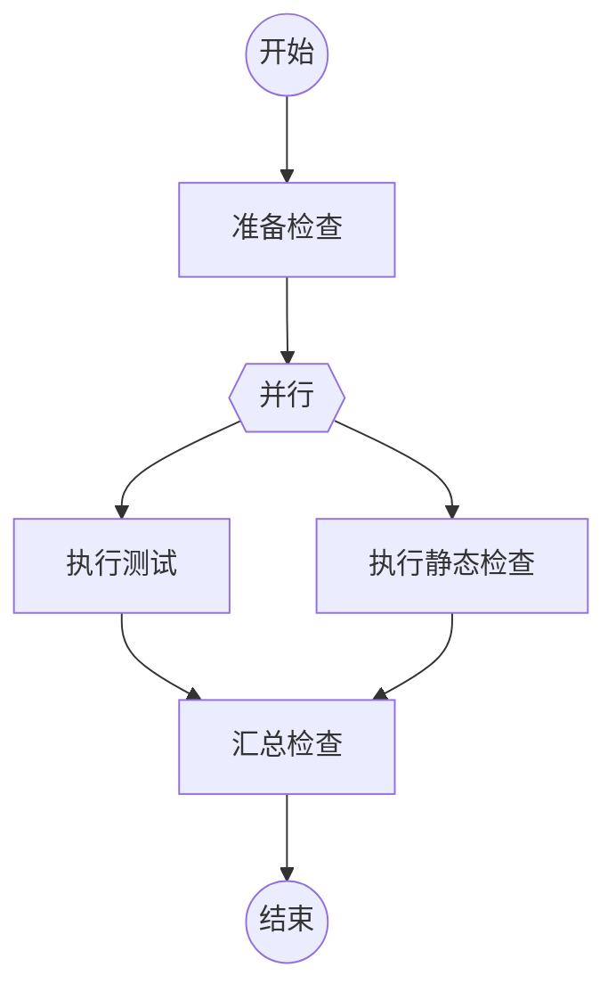

# Flow 变量作用域设计

## 1. 目标

Flow 中的数据只通过显式变量传递，`result` 只负责选择结果边。

变量有两种基本作用域：

- **全局变量**：在 Flow 元信息中声明，属于当前 Run，后续节点都可以读取。
- **下一跳变量**：在节点结果下声明，只传给实际进入的下一节点。它不会自动写入 Run 全局状态。

并行分支是下一跳变量的特殊场景：分支输出在汇合节点以分支名隔离读取，汇合完成后不再继续存在。

这套设计只解决数据如何声明、读取和传递，不在本文展开变量类型系统、审计、恢复和复杂表达式。

## 2. 变量声明

### 2.1 全局变量

全局变量只在 `FLOW.md` 元信息中声明：

```yaml
---
name: 评审与修复
description: 对目标进行评审并完成修复。

variables:
  任务:
    description: 本次需要完成的工作目标
  项目:
    description: 待处理的项目
  检查范围:
    description: 需要覆盖的检查范围
    default: 全部
---
```

规则：

- 只有出现在元信息 `variables` 中的名称才是全局变量。
- 启动参数只能为已声明的全局变量提供初始值。
- 有 `default` 的变量可以省略启动值。
- 没有默认值的全局变量必须由启动参数提供。
- 节点可以覆盖已声明的全局变量。
- 节点不能通过提交结果新增全局变量。

全局变量使用 `{var.xxx}` 读取：

```text
任务：{var.任务}
项目：{var.项目}
检查范围：{var.检查范围}
```

### 2.2 下一跳变量

节点结果下声明的变量属于下一跳作用域：

```markdown
### 需要修改

| 变量 | 含义 |
| --- | --- |
| 问题清单 | 评审发现的必须修复的问题 |
| 修改建议 | 针对问题给出的修复方案 |

发现了必须修复的问题，进入修复节点。
```

节点提交：

```json
{
  "outcome": "需要修改",
  "variables": {
    "问题清单": ["问题一", "问题二"],
    "修改建议": "调整模板变量解析逻辑"
  }
}
```

下一节点使用 `{input.xxx}` 读取：

```text
问题清单：{input.问题清单}
修改建议：{input.修改建议}
```

规则：

- 下一跳变量只对实际进入的下一个节点可见。
- 循环再次进入节点时，上一轮的下一跳变量不会自动保留。
- 下一跳变量不能被其他路径上的节点读取。
- 同一个名称不能同时作为全局变量和下一跳变量声明，避免作用域遮蔽。
- 没有声明为全局变量或当前结果下一跳变量的提交字段无效。

节点读取的数据由两部分组成：

```text
全局变量：{var.xxx}
上一节点输出：{input.xxx}
```

## 3. 节点结果协议

节点结果只包含路由结果和变量更新：

```typescript
export interface NodeOutcome {
  result: string;
  variables?: FlowVariables;
}
```

运行时根据变量声明位置决定作用域：

- 变量名出现在 Flow 元信息中，写入 Run 全局变量。
- 变量名出现在当前结果的变量表中，作为下一跳变量传递。
- 同名变量不能同时出现在两处。
- 未声明的变量拒绝提交。

例如，Flow 元信息声明了 `项目`，当前结果声明了 `问题清单`：

```json
{
  "result": "需要修改",
  "variables": {
    "项目": "Agent-Flow-Runtime",
    "问题清单": ["变量解析错误"]
  }
}
```

提交后：

- `项目`进入 Run 全局变量，后续节点可以使用 `{var.项目}`。
- `问题清单`只进入下一节点，下一节点使用 `{input.问题清单}`。

`result` 只选择结果边，不携带自然语言正文。需要传递的结论、证据或状态必须声明为变量。

## 4. 串行路径

普通节点使用全局变量和上一节点输出：

````markdown
## 执行评审

```新建Agent
请执行代码评审。

任务：{var.任务}
项目：{var.项目}
检查范围：{var.检查范围}
```

### 需要修改

| 变量 | 含义 |
| --- | --- |
| 问题清单 | 评审发现的必须修复的问题 |
| 修改建议 | 针对问题给出的修复方案 |
````
修复节点读取：

````markdown
## 落实修复

```复用Agent
请根据以下内容完成修复。

项目：{var.项目}
问题清单：{input.问题清单}
修改建议：{input.修改建议}
```
````

如果修复节点再次进入评审节点，修复节点的输出只传给本次进入的评审节点。更早路径上的 `input` 不会残留。

## 5. 分支数据

分支专属数据使用下一跳作用域，不写入全局变量。

示例：



两个分支可以使用相同的变量名：

```markdown
### 已完成

| 变量 | 含义 |
| --- | --- |
| 状态 | 本分支的检查状态 |
| 摘要 | 本分支的检查摘要 |
```

汇合节点通过分支引用读取：

```text
测试状态：{branch.test.状态}
测试摘要：{branch.test.摘要}
静态检查状态：{branch.lint.状态}
静态检查摘要：{branch.lint.摘要}
```

规则：

- 并行开始时，开始节点的 `input` 快照复制给每个分支。
- 分支只能读取全局变量、并行开始时的输入和本分支上一节点的输出。
- 分支不能读取其他分支的 `input` 或 `branch` 数据。
- 汇合节点可以读取每个已完成分支的最后一跳输出，格式为 `{branch.<分支引用>.<变量>}`。
- 分支输出按分支引用隔离，不进行平面合并，也不发生同名覆盖。
- 汇合节点产生的变量重新成为普通下一跳变量，离开汇合节点后只能通过 `{input.xxx}` 读取。
- 需要在汇合节点之后继续保留的数据，由汇合节点显式写入已声明的全局变量。

例如汇合节点提交：

```json
{
  "result": "检查通过",
  "variables": {
    "检查结论": "测试和静态检查均通过"
  }
}
```

如果 `检查结论` 是元信息中的全局变量，后续节点使用 `{var.检查结论}`。如果它只出现在汇合结果的变量表中，后续节点使用 `{input.检查结论}`。

分支只有在确实需要影响整个 Run 的状态时，才应写入元信息中声明的全局变量。多个分支写入同一个全局变量时，运行时必须检测冲突；分支专属数据不应通过全局变量表达。

## 6. 子 Flow

子 Flow 使用显式输入和输出，不复制父 Flow 的完整变量快照。

父 Flow 调用子 Flow：

```json
{
  "flow": "security-check",
  "inputs": {
    "项目": "{var.项目}",
    "版本": "{input.版本}"
  }
}
```

这里的 `inputs` 是子 Flow 的启动输入，名称必须是子 Flow 元信息中声明的全局变量。

子 Flow 完成后，输出作为父 Flow 当前节点的下一跳变量：

```json
{
  "result": "已完成",
  "variables": {
    "安全状态": "通过",
    "风险数量": 0
  }
}
```

规则：

- 子 Flow 只接收调用方显式传入的变量。
- 子 Flow 使用自己的全局变量声明和自己的 Run 状态。
- 子 Flow 的内部全局变量不会自动回传父 Flow。
- 子 Flow 只能返回父节点结果中声明的下一跳变量。
- 父 Flow 需要长期保留子 Flow 输出时，由父 Flow 当前节点将其写入自己的全局变量。
- 子 Flow 失败时不产生可供父 Flow 读取的下一跳变量。

## 7. 最小运行模型

一次节点提交只做三件事：

```text
1. 用 result 选择结果边。
2. 将已声明的全局变量写入 Run 快照。
3. 将其他已声明变量作为下一跳输入保存。
```

Run 只需要维护：

```text
全局变量快照
当前节点位置
当前节点输入
并行轮次中的各分支当前输入
```

节点完成、全局变量更新、下一跳输入和路由结果作为一次节点事实提交，避免恢复时出现部分生效。

## 8. 明确不做的事情

本设计暂不增加：

- `{outcome}` 或隐式上一个节点正文
- 全局变量的自动推断和自动新增
- 全局变量与下一跳变量的隐式合并
- 分支变量的平面合并
- 子 Flow 完整变量快照回传
- 变量删除协议
- 对象路径表达式
- 复杂类型系统和 JSON Schema
- stdout、Agent 会话消息或执行证据自动进入业务变量

核心规则只有三条：

1. 元信息声明的变量是全局变量，使用 `{var.xxx}`。
2. 节点结果声明的变量只传给下一节点，使用 `{input.xxx}`。
3. 并行分支输出在汇合节点按 `{branch.<分支引用>.<变量>}` 隔离读取。
