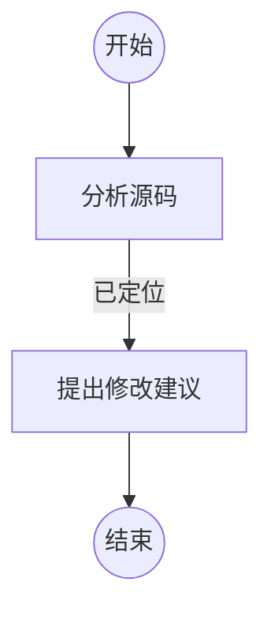

# Flow 运行变量设计

## 1. 设计目标

Flow 运行需要同时传递两类信息：节点之间的处理消息，以及贯穿一次运行的结构化上下文。当前 `{outcome}` 同时承担这两类职责，首节点把用户输入当作 `{outcome}`，后续节点又把上一个节点的结果当作 `{outcome}`，导致首节点和普通节点的输入语义不同。

本设计将运行上下文拆分为两个概念：

- `variables`：一次 Flow Run 的结构化变量集合，首节点即可读取，节点可以追加或更新。
- `outcome`：上一个节点产生的 `content`，只负责相邻节点之间的消息传递。

模板统一使用以下两种引用。运行时同时接受单花括号书写和双花括号书写，Flow 文件建议使用单花括号：

```text
{var.待处理的源码位置}
{outcome}
```

首节点使用 `variables` 读取首次运行输入。首节点完成后，后续节点使用 `{outcome}` 读取上游节点消息，并继续读取当前变量集合。

## 2. 适用范围

变量属于一次 Flow Run。不同 Run 之间互相隔离，变量不会进入进程级全局状态，也不会自动写入其他正在运行的 Flow。

变量覆盖以下执行范围：

- Agent 节点
- 自定义命令节点
- 子 Flow 节点
- 普通串行路径
- 循环路径
- 并行路径及其汇合节点
- 中断后的恢复运行

模板渲染、变量更新和持久化由运行时统一处理，三类节点使用相同的变量语义。

## 3. 核心模型

### 3.1 Flow Run 上下文

一次运行包含以下状态：

```text
variables       当前变量快照
outcome         当前节点收到的上游消息
node position   当前执行位置
route state     路由和并行状态
```

首节点启动时：

```text
variables = Flow 默认变量 + 本次运行变量
outcome = 不存在
```

普通节点启动时：

```text
variables = 当前 Run 变量快照
outcome = 上一个节点的 outcome.content
```

节点提交完成后，运行时产生：

```text
node outcome
variable patch
route decision
```

这些事实作为一次状态提交保存。

### 3.2 变量类型

变量值使用现有 `FlowValue` 类型：

```typescript
type FlowValue =
  | string
  | number
  | boolean
  | null
  | FlowValue[]
  | { [key: string]: FlowValue };
```

变量名使用以下规则：

- 变量名为非空字符串。
- 变量引用使用 `{var.<name>}`。
- 第一版支持字母、数字、下划线、连字符和中文字符。
- 点号作为变量命名空间分隔符，不作为普通变量名字符。
- `__proto__`、`prototype`、`constructor` 等对象原型相关名称禁止使用。
- `undefined` 不属于变量值，空值使用 `null`。

第一版支持顶层变量引用：

```text
{var.项目名称}
{var.待处理的源码位置}
```

对象路径引用可以作为后续扩展：

```text
{var.project.name}
{var.source.path}
```

对象路径扩展加入前，需要明确变量名中点号的兼容规则。

### 3.3 模板占位符

`{outcome}` 的定义为：

> 当前节点收到的上一个节点 `NodeOutcome.content`。

它不包含结果名 `result`、变量集合或完整的 `NodeOutcome` 对象。

`{var.xxx}` 的定义为：

> 当前 Flow Run 变量快照中名为 `xxx` 的值。

首节点没有上游节点消息，因此首节点使用 `{outcome}` 属于 Flow 定义错误。首节点可以读取初始变量和 Flow 默认变量。

模板渲染器需要识别以下错误：

- `{outcome}` 出现在首节点。
- `{var.xxx}` 引用不存在的变量。
- 变量路径语法不合法。
- 对象路径的中间值不是对象。
- 变量类型不适合当前输出位置。

未定义变量直接导致当前节点失败，并返回变量引用错误。空值 `null` 是已定义变量，可以按模板类型规则正常渲染。

## 4. 首次运行

### 4.1 输入结构

运行入口以变量集合为主要输入：

```typescript
flowCoordinator.run({
  variables: {
    任务: "检查项目中的模板渲染问题",
    待处理的源码位置: "src/runtime.ts",
    项目名称: "Agent-Flow-Runtime",
  },
});
```

Flow 默认变量由 Flow 定义提供。本次运行变量覆盖同名默认值并补充新变量：

```text
Flow 默认变量
  → 本次运行变量
  → 节点变量更新
```

运行入口不再为模板提供独立的 `task` 特殊变量。用户任务可以使用任意变量名，例如：

```text
{var.任务}
{var.用户需求}
{var.检查目标}
```

CLI 提供便捷参数：

```text
/flow run review \
  --var 任务="检查模板渲染问题" \
  --var 待处理的源码位置=src/runtime.ts
```

复杂变量通过 JSON 文件传入：

```text
/flow run review --variables ./flow-vars.json
```

```json
{
  "任务": "检查项目中的模板渲染问题",
  "待处理的源码位置": "src/runtime.ts",
  "检查范围": ["模板渲染", "命令参数"]
}
```

### 4.2 Flow 默认变量

Flow 可以为变量提供默认值。默认变量属于 Flow 定义，运行时读取后复制到 Run 变量快照：

```yaml
variables:
  输出语言: 中文
  检查范围: 全部源码
```

默认值用于补齐通用上下文。本次运行传入的同名变量优先级更高。

默认变量的定义和解析规则需要纳入 Flow 指纹。运行时变量不纳入 Flow 指纹，变量属于 Run 状态而不是 Flow 定义。

### 4.3 首节点示例

```markdown
## 分析任务

```新建Agent
任务：{var.任务}
项目：{var.项目名称}
源码位置：{var.待处理的源码位置}

请分析任务并定位需要处理的代码。
```
```

首节点没有隐式输入。Agent、命令和子 Flow 首节点遵循同样的规则。

## 5. 节点变量更新

### 5.1 Agent 节点

Agent 通过 `submit_flow_outcome` 同时提交节点结果和变量补丁：

```json
{
  "outcome": "已定位源码",
  "content": "已找到需要处理的文件",
  "variables": {
    "问题类型": "模板渲染",
    "建议修改位置": "src/runtime.ts:1995"
  }
}
```

`variables` 表示增量更新，不要求 Agent 重复提交完整变量表。新变量自动创建，同名变量按照变量覆盖规则更新。

节点提交后，后续节点可以读取：

```text
上一个节点的消息：
{outcome}

问题类型：
{var.问题类型}

修改位置：
{var.建议修改位置}
```

### 5.2 命令节点

命令节点使用 `output: "variables"` 显式声明结构化变量结果。启用后，命令输出采用约定的 JSON 信封：

```json
{
  "content": {
    "检查结果": "通过"
  },
  "variables": {
    "检查状态": "通过",
    "发现数量": 0
  }
}
```

普通文本标准输出只产生 `content`，不自动推断变量。变量写入必须通过结构化结果或节点配置完成。

命令进程返回无效的变量信封时，节点失败并返回结构化输出错误。

### 5.3 子 Flow 节点

子 Flow 成功完成时，子 Run 可以返回：

```text
子 Flow 最终 outcome
子 Flow 变量更新
```

父 Flow 将其作为当前“执行 Flow”节点的一次结果接收，并根据子 Flow 节点结果完成变量合并。父 Flow 不直接读取子 Run 的可变快照。

## 6. 变量更新规则

### 6.1 增量更新

变量更新使用增量补丁：

```json
{
  "set": {
    "问题类型": "模板渲染",
    "检查状态": "通过"
  },
  "delete": ["临时目录"]
}
```

对外提交协议可以继续使用简化形式：

```json
{
  "variables": {
    "问题类型": "模板渲染"
  }
}
```

运行时将其解释为 `set`。需要删除变量时使用明确的 `delete` 结构，`null` 只表示变量值为空。

第一版采用浅层替换：更新对象字段时替换整个顶层变量值，不自动深度合并对象。深度更新可以在对象路径语法确定后再加入。

### 6.2 覆盖规则

变量值的来源按以下优先级生效：

```text
Flow 默认变量 < 首次运行变量 < 节点变量更新
```

节点更新同名变量时直接覆盖当前值。每次覆盖都记录来源节点和旧值摘要。

变量更新可以覆盖首次运行变量。变量没有只读属性，保护关键值通过 Flow 设计约定和运行审计实现。后续需要权限控制时，可以增加只读变量定义，但不作为第一版前置条件。

### 6.3 原子性和幂等

节点结果、变量补丁和路由事实必须在同一个 `RunFactCommit` 中提交：

```text
NodeRun completed
+ outcome
+ variable patch
+ current variables snapshot
+ route decision
```

节点重试遵循以下规则：

- 已成功提交的变量补丁不重复应用。
- 节点尚未提交时，重试产生新的 NodeRun 执行记录。
- 变量更新使用提交 ID 或 NodeRun ID 去重。
- 恢复时以最后一个成功事实提交为准。

## 7. 并行分支

并行分支从并行开始点获得相同的变量快照。分支执行期间各自维护局部变量补丁：

```text
parallel start variables snapshot
  ├─ branch A local patch
  └─ branch B local patch
```

分支变量更新不会实时写入共享 Run 变量，因此一个分支不能依赖另一个分支尚未汇合的变量更新。

汇合时采用冲突检测策略：

- 不同分支更新不同变量：合并成功。
- 多个分支更新同一变量且值相同：合并成功。
- 多个分支更新同一变量且值不同：并行轮次失败，返回变量冲突错误。
- 分支删除变量与其他分支更新同名变量：视为冲突。
- 未产生更新的分支不参与冲突判断。

合并按照 Flow 图中分支声明顺序执行，但声明顺序只用于生成稳定的冲突报告，不用于覆盖变量。最终结果不依赖分支完成顺序。

汇合节点读取合并后的变量快照。汇合节点的 `{outcome}` 需要单独定义：

- 普通并行汇合节点不提供单一 `{outcome}`。
- 汇合节点需要分支消息时，继续使用现有的 `{分支引用.outcome}` 机制。
- 汇合节点可以读取合并后的 `{var.xxx}`。

## 8. 子 Flow

子 Flow 在启动时复制父 Flow 当前变量快照：

```text
parent variables at child start
  → child variables snapshot
```

子 Flow 在自己的 Run 内独立更新变量。父 Flow 不读取子 Flow 的中间变量。

子 Flow 成功完成时，父节点接收子 Flow 的最终 outcome 和变量补丁。父 Flow 将二者与执行 Flow 节点的路由状态一起提交。

以下状态下的传播规则保持一致：

| 子 Flow 状态 | 父 Flow 变量更新 | 父节点结果 |
|---|---:|---:|
| 成功 | 提交 | 继续路由 |
| 失败 | 不提交 | 按失败路径处理 |
| 中断 | 不提交 | 父 Run 保持可恢复 |
| 恢复后成功 | 只提交一次 | 继续路由 |

子 Flow 的首节点同样禁止 `{outcome}`，只读取复制得到的 `{var.xxx}`。

## 9. 模板类型规则

模板渲染需要区分文本位置和结构化值位置。

### 9.1 文本位置

Agent Prompt 始终是文本。变量为标量时转换为文本，变量为对象或数组时使用 JSON 文本：

```text
配置：{var.config}
```

```json
配置：{"mode":"strict"}
```

字符串嵌入对象或数组时采用 JSON 序列化。`null` 渲染为 `null` 文本。

### 9.2 结构化位置

命令请求、命令参数、stdin 和子 Flow 的变量覆盖保留结构化类型。当一个字符串值完整匹配单个变量占位符时，返回变量原值：

```json
{
  "stdin": "{var.config}"
}
```

如果 `config` 是对象，渲染后的 `stdin` 仍是对象。

嵌入其他文本时使用字符串渲染：

```json
{
  "args": ["--project={var.项目名称}"]
}
```

这里的参数始终是字符串。

`{outcome}` 使用相同的类型规则。独立占位符保留 `content` 原值，嵌入字符串时进行文本化。

## 10. 持久化和恢复

### 10.1 Run 记录

`FlowRunRecord` 保存当前变量快照：

```typescript
interface FlowRunRecord {
  id: string;
  flowId: string;
  flowVersion: string;
  variables: Record<string, FlowValue>;
  // 当前节点、状态、序列号等既有字段
}
```

首节点不再使用 `task` 作为 `currentInput`。初始运行上下文为：

```text
currentInput = null
variables = 初始变量合并后的快照
```

旧运行记录没有 `variables` 时，按空对象加载。旧运行的首节点语义属于历史版本，恢复时根据运行记录的 `historyCompleteness` 和 Flow 版本执行明确的兼容判断。

### 10.2 变量变更审计

当前变量快照用于执行和恢复。每次变量更新至少记录：

```text
runId
nodeRunId
parallelRoundId（存在时）
commitId
updated keys
old value summary
new value summary
```

变量完整值是否进入默认日志由敏感信息策略决定。观察事件展示变量名和变更摘要，详情查询再读取完整值。

### 10.3 恢复语义

恢复时加载最近一次完整事实提交：

```text
variables snapshot
current node
current input/outcome
route state
parallel state
```

如果节点结果和变量更新已经同批提交，恢复直接继续路由。如果节点执行记录存在但结果尚未提交，按既有节点恢复策略重试或中断处理，变量补丁不会提前生效。

子 Flow 已完成但父节点尚未提交时，父 Run 恢复需要根据子 Run 的唯一完成事实接收一次结果，重复恢复不能重复应用变量补丁。

## 11. 解析和错误处理

Flow 加载阶段检查静态模板：

- 模板占位符格式。
- 变量名称格式。
- 首节点是否使用 `{outcome}`。
- 子 Flow task、命令请求和 Agent Prompt 中的引用位置。
- 并行分支引用格式。

运行阶段检查动态条件：

- 变量是否存在。
- 变量值是否满足当前模板位置的类型要求。
- 并行合并是否发生变量冲突。
- 子 Flow 返回的变量补丁是否有效。
- 变量快照和事实提交是否成功。

错误类别至少包括：

```text
variable_reference
variable_type
variable_conflict
variable_persistence
variable_recovery
```

错误信息包含 Flow、Run、节点、变量名和模板位置，便于定位。

## 12. API 和类型变化

核心类型调整方向：

```typescript
export type FlowVariables = Record<string, FlowValue>;

export interface NodeOutcome {
  result: string;
  content: FlowValue;
  variables?: FlowVariables;
}

export interface FlowRunRecord {
  // 既有字段
  variables: FlowVariables;
}
```

运行入口调整为变量优先：

```typescript
run({
  variables,
  options,
});
```

`FlowCoordinator`、命令执行器、Agent 模型和子 Flow 调用统一接收变量上下文。模板渲染统一收口到一个渲染器：

```typescript
renderTemplate(value, {
  outcome,
  variables,
  branchOutcomes,
  position,
});
```

其中 `position` 用于区分 Agent 文本、命令结构化值和 Flow task。

## 13. 文档示例

````markdown
---
name: 代码检查
description: 检查指定源码并输出修改建议。
---



## 分析源码

```新建Agent
任务：{var.任务}
项目：{var.项目名称}
源码位置：{var.待处理的源码位置}

请分析源码，并返回问题定位结果。
```

## 提出修改建议

```新建Agent
上一节点结果：
{outcome}

源码位置：{var.待处理的源码位置}
问题类型：{var.问题类型}

请给出修改建议。
```
````

首次运行变量：

```json
{
  "任务": "检查模板变量渲染",
  "项目名称": "Agent-Flow-Runtime",
  "待处理的源码位置": "src/runtime.ts"
}
```

首节点通过变量获取全部启动信息。首节点产生的 `问题类型` 可以随节点结果写入，第二节点继续使用。

## 14. 验收标准

### 首次运行

- 首节点可以读取首次运行传入的变量。
- 首节点使用 `{outcome}` 时在 Flow 加载阶段失败。
- 首节点不使用隐式用户输入。
- 变量默认值、首次运行变量和节点更新按既定优先级合并。

### 普通节点

- Agent、命令、子 Flow 使用同一套 `{var.xxx}` 语义。
- `{outcome}` 始终等于上一个节点的 `content`。
- 变量更新可以新增、覆盖和删除变量。
- 变量更新和节点 outcome 一起原子提交。
- 未定义变量产生稳定的变量引用错误。

### 类型和模板

- 文本模板可以渲染标量、对象、数组和 null。
- 结构化参数中的独立变量占位符保留原类型。
- 字符串嵌入始终生成字符串。
- Agent、命令和子 Flow 的类型行为一致。

### 并行和子 Flow

- 不同并行分支更新不同变量时可以合并。
- 同名变量产生不同值时报告冲突。
- 并行完成顺序不改变最终变量结果。
- 子 Flow 使用启动时变量快照。
- 子 Flow 成功时变量更新只回写一次。
- 子 Flow 失败或中断时变量更新不会写入父 Flow。

### 恢复和审计

- 恢复后变量快照与中断前最后一次完整提交一致。
- 节点重试不会重复应用变量补丁。
- 子 Flow 恢复不会重复回写父 Flow 变量。
- 变量更新可以追溯到 Run、节点和提交记录。
- 旧运行记录可以按明确规则加载和处理。

## 15. 实施顺序

1. 增加 `FlowVariables`、节点变量更新和 Run 变量快照类型。
2. 定义 Flow 默认变量和运行入口变量格式。
3. 实现统一模板解析器，加入首节点 `{outcome}` 静态校验。
4. 调整首节点输入模型，使首节点 `outcome` 为空。
5. 将变量上下文接入 Agent、命令和子 Flow 三类节点。
6. 扩展 Agent 提交协议，支持变量补丁。
7. 实现命令和子 Flow 的结构化变量结果。
8. 将变量更新纳入 RunFactCommit，并补充恢复幂等处理。
9. 实现并行分支变量快照、冲突检测和汇合合并。
10. 更新 Flow 规范、运行入口帮助和示例。
11. 补充入口、模板、类型、并发、子 Flow、持久化和恢复测试。
