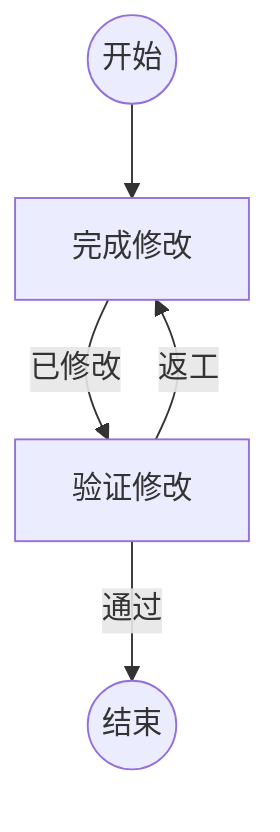

## 完成修改

```新建Agent
完成以下代码修改：
{var.任务}
最新修改与返工记录：{var.修改记录}
完成后在 variables.修改记录 中提交修改范围和验证所需信息。
```

### 已修改

修改已完成，已更新全局变量 `修改记录`。

## 验证修改

```复用Agent
验证以下修改结果：
{var.修改记录}
```

### 通过

验证已通过。

### 返工

验证发现需要回到修改节点的问题，更新全局变量 `修改记录`，列出返工原因。