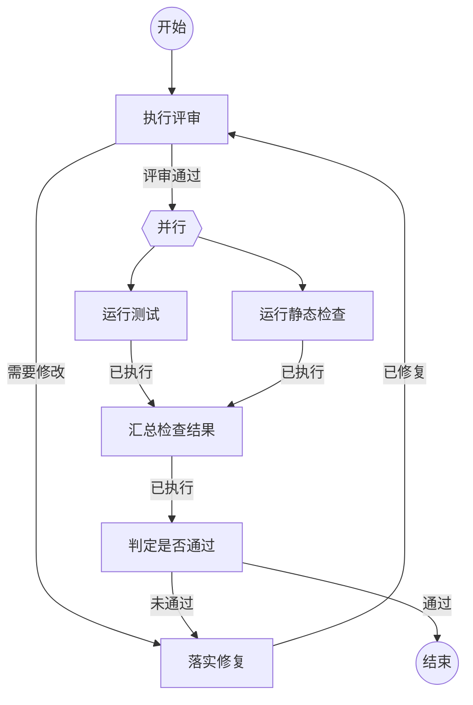

修改指南（本段和 Mermaid 注释只给人看，不会进入 Agent 提示词）：

- 文件由三部分组成：开头元信息、一张 Mermaid 图、每个工作节点一个二级标题。
- Agent 收到的提示词只有三样：节点动作代码块内容、本节点各结果的三级标题说明、固定的提交指令。
- 改提示词：修改对应节点代码块内的文字；`{outcome}` 会被替换为进入本节点的结果内容。首节点的提示词必须写 `{outcome}`，流程开始任务才会进入流程。
- 改路径：修改图中的连线；每条结果边必须在对应节点下有同名三级标题，标题下的说明会注入提示词。
- 加节点：图中写 `引用名[节点名称]`，再新增同名二级标题；不对应节点的二级标题会报错。
- 并行分支必须是命令节点，命令节点只有“已执行”一个结果；汇合命令在 `stdin` 中用 `{分支引用名.outcome}` 引用各分支结果。



## 执行评审

```新建Agent
评审以下工作成果，列出必须修复的问题：
{outcome}
只报告有证据的问题，不直接修改实现。
```

### 需要修改

列出必须修复的问题和对应位置，流程进入修复节点。

### 评审通过

未发现必须修复的问题，流程进入并行检查。

## 落实修复

```复用Agent
修复以下评审问题，逐条说明改动：
{outcome}
只修复列出的问题，不做无关改动。
```

### 已修复

已按清单完成修复并说明每条改动，流程回到评审节点。

## 运行测试

```执行自定义命令
{
  "command": "npm",
  "args": ["test"]
}
```

### 已执行

测试命令已运行，输出保存在结果内容中。

## 运行静态检查

```执行自定义命令
{
  "command": "npm",
  "args": ["run", "check"]
}
```

### 已执行

静态检查命令已运行，输出保存在结果内容中。

## 汇总检查结果

```执行自定义命令
{
  "command": "node",
  "args": [
    "-e",
    "let s='';process.stdin.on('data',c=>s+=c).on('end',()=>console.log(s))"
  ],
  "stdin": {
    "test": {test.outcome},
    "lint": {lint.outcome}
  }
}
```

### 已执行

已汇总两个分支的完整结果，供判定节点使用。

## 判定是否通过

```复用Agent
根据以下汇总判定本次工作是否通过：
{outcome}
测试或检查失败时，提取可修复的原因并提交“未通过”。
```

### 通过

全部检查通过，本次工作结束。

### 未通过

检查未通过，结果内容包含失败原因，流程回到修复节点。
