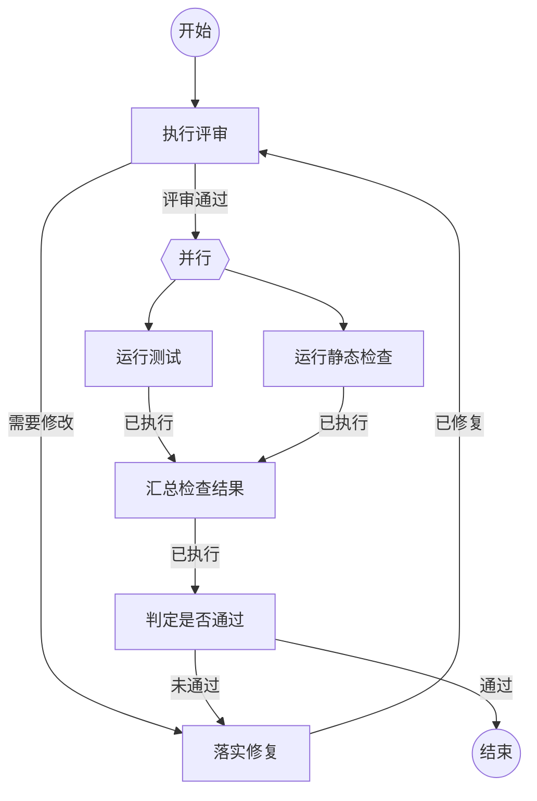

修改指南（本段和 Mermaid 注释只给人看，不会进入 Agent 提示词）：

- 文件由三部分组成：开头元信息、一张 Mermaid 图、每个工作节点一个二级标题。
- Agent 收到的提示词只有三样：节点动作代码块内容、本节点各结果的三级标题说明、固定的提交指令。
- 改提示词：修改对应节点代码块内的文字；全局变量使用 `{var.xxx}`，上一节点结果变量使用 `{input.xxx}`。首节点使用 `{var.任务}` 接收流程启动输入。
- 改路径：修改图中的连线；每条结果边必须在对应节点下有同名三级标题，标题下的说明会注入提示词。
- 加节点：图中写 `引用名[节点名称]`，再新增同名二级标题；不对应节点的二级标题会报错。
- 并行分支必须是命令节点，命令节点只有“已执行”一个结果；命令通过 `output: "variables"` 以 `{"variables": {...}}` 输出业务变量，汇合命令在 `stdin` 中用 `{branch.分支引用名.变量}` 引用。



## 执行评审

```新建Agent
执行以下任务：
{var.任务}
最新记录：{var.评审记录}
只报告有证据的问题，不直接修改实现。
```

### 需要修改

| 变量 | 含义 |
| --- | --- |
| 问题清单 | 必须修复的问题和对应位置 |

列出必须修复的问题和对应位置，流程进入修复节点。

### 评审通过

未发现必须修复的问题，流程进入并行检查。

## 落实修复

```复用Agent
修复以下评审问题，逐条说明改动：
{input.问题清单}
只修复列出的问题，不做无关改动。
```

### 已修复

已按清单完成修复，更新全局变量 `评审记录` 说明每条改动，流程回到评审节点。

## 运行测试

```执行自定义命令
{
  "command": "node",
  "args": ["-e", "const r=require('node:child_process').spawnSync('npm',['test'],Object.fromEntries([['encoding','utf8']]));console.log(JSON.stringify(Object.fromEntries([['variables',Object.fromEntries([['摘要',Object.fromEntries([['status',r.status===0?'success':'failure'],['exitCode',r.status],['stdout',r.stdout],['stderr',r.stderr]])]])]])));"],
  "output": "variables"
}
```

### 已执行

| 变量 | 含义 |
| --- | --- |
| 摘要 | 测试状态、退出码和输出摘要 |

测试命令已运行，执行证据保存在 `commandResult`。

## 运行静态检查

```执行自定义命令
{
  "command": "node",
  "args": ["-e", "const r=require('node:child_process').spawnSync('npm',['run','check'],Object.fromEntries([['encoding','utf8']]));console.log(JSON.stringify(Object.fromEntries([['variables',Object.fromEntries([['摘要',Object.fromEntries([['status',r.status===0?'success':'failure'],['exitCode',r.status],['stdout',r.stdout],['stderr',r.stderr]])]])]])));"],
  "output": "variables"
}
```

### 已执行

| 变量 | 含义 |
| --- | --- |
| 摘要 | 静态检查状态、退出码和输出摘要 |

静态检查命令已运行，执行证据保存在 `commandResult`。

## 汇总检查结果

```执行自定义命令
{
  "command": "node",
  "args": [
    "-e",
    "let s='';process.stdin.on('data',c=>s+=c).on('end',()=>console.log(JSON.stringify(Object.fromEntries([['variables',Object.fromEntries([['评审记录',JSON.parse(s)]])]]))))"
  ],
  "output": "variables",
  "stdin": {
    "test": {branch.test.摘要},
    "lint": {branch.lint.摘要}
  }
}
```

### 已执行

已汇总两个分支的业务摘要，写入全局变量 `评审记录`，供判定节点使用。

## 判定是否通过

```复用Agent
根据以下汇总判定本次工作是否通过：
{var.评审记录}
测试或检查失败时，提取可修复的原因并提交“未通过”。
```

### 通过

全部检查通过，本次工作结束。

### 未通过

| 变量 | 含义 |
| --- | --- |
| 问题清单 | 本轮检查失败原因及修复方向 |

检查未通过，`问题清单` 包含失败原因，流程回到修复节点。
