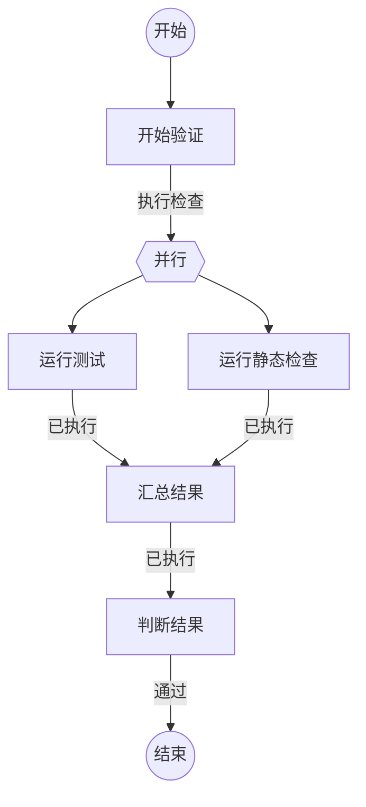

## 开始验证

```新建Agent
准备验证以下任务：
{var.任务}
在 variables.检查上下文 中提交本轮检查目标。
```

### 执行检查

| 变量 | 含义 |
| --- | --- |
| 检查上下文 | 本轮分支检查目标 |

开始独立检查。

## 运行测试

```执行自定义命令
{
  "command": "test",
  "stdin": { "task": "{var.任务}", "context": "{input.检查上下文}" },
  "output": "variables"
}
```

### 已执行

| 变量 | 含义 |
| --- | --- |
| 摘要 | 测试命令通过变量信封提交的检查摘要 |

测试命令已经执行，执行证据保存在 commandResult。

## 运行静态检查

```执行自定义命令
{
  "command": "lint",
  "stdin": { "task": "{var.任务}", "context": "{input.检查上下文}" },
  "output": "variables"
}
```

### 已执行

| 变量 | 含义 |
| --- | --- |
| 摘要 | 静态检查命令通过变量信封提交的检查摘要 |

静态检查命令已经执行，执行证据保存在 commandResult。

## 汇总结果

```执行自定义命令
{
  "command": "merge",
  "output": "variables",
  "stdin": {
    "task": "{var.任务}",
    "test": {branch.test.摘要},
    "lint": {branch.lint.摘要}
  }
}
```

### 已执行

| 变量 | 含义 |
| --- | --- |
| 汇总结果 | 汇总命令通过变量信封提交的本轮检查结果 |

已汇总本轮检查结果。

## 判断结果

```复用Agent
判断汇总结果：
{input.汇总结果}
```

### 通过

验证已通过。
