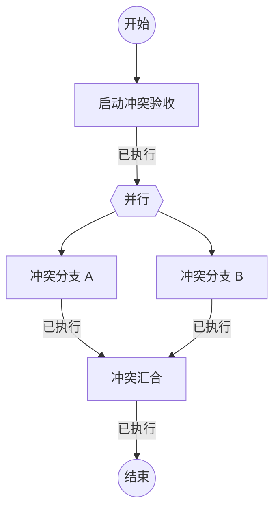

## 启动冲突验收

```执行自定义命令
{"command":"setup-conflict"}
```

### 已执行

冲突验收已启动。

## 冲突分支 A

```执行自定义命令
{"command":"conflict-a","output":"variables"}
```

### 已执行

分支 A 已完成，变量信封将全局变量 `冲突变量` 更新为 A。

## 冲突分支 B

```执行自定义命令
{"command":"conflict-b","output":"variables"}
```

### 已执行

分支 B 已完成，变量信封将全局变量 `冲突变量` 更新为 B。

## 冲突汇合

```执行自定义命令
{"command":"merge-conflict","stdin":{"a":{branch.a.冲突变量},"b":{branch.b.冲突变量}}}
```

### 已执行

冲突汇合已完成。
