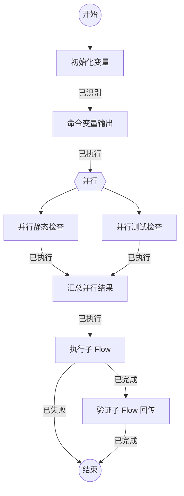

## 初始化变量

```新建Agent
这是发布级 Flow 验收。任务：{var.任务}。项目：{var.项目}。默认范围：{var.默认检查范围}。
请确认初始变量已经进入当前节点，并提交结果。
```

### 已识别

首节点已读取初始变量，并在 `variables` 中更新全局变量 `agent标记` 和 `项目`。

## 命令变量输出

```执行自定义命令
{"command":"node","args":["scripts/check.mjs","emit"],"output":"variables","stdin":{"message":"{var.任务}","project":"{var.项目}"}}
```

### 已执行

命令变量输出已完成，标准输出信封中的 `command状态`、`命令计数` 写入全局变量。

## 并行静态检查

```执行自定义命令
{"command":"node","args":["scripts/check.mjs","lint"],"output":"variables","stdin":"{var.任务}"}
```

### 已执行

| 变量 | 含义 |
| --- | --- |
| lint状态 | 静态检查分支状态 |

静态检查分支已完成。

## 并行测试检查

```执行自定义命令
{"command":"node","args":["scripts/check.mjs","test"],"output":"variables","stdin":"{var.任务}"}
```

### 已执行

| 变量 | 含义 |
| --- | --- |
| test状态 | 测试检查分支状态 |

测试检查分支已完成。

## 汇总并行结果

```执行自定义命令
{"command":"node","args":["scripts/check.mjs","merge"],"output":"variables","stdin":{"lint":{branch.lint.lint状态},"test":{branch.test.test状态},"command状态":"{var.command状态}"}}
```

### 已执行

| 变量 | 含义 |
| --- | --- |
| 汇总结果 | 本轮命令、静态检查和测试的汇总状态 |

并行结果已汇总。

## 执行子 Flow

```执行Flow
{"flow":"child-flow","inputs":{"子任务":"{input.汇总结果}","父侧变量":"{var.项目}"}}
```

### 已完成

| 变量 | 含义 |
| --- | --- |
| 子结果 | 子 Flow 终节点返回的验收结论 |

子 Flow 已完成。

### 已失败

子 Flow 未完成。

## 验证子 Flow 回传

```新建Agent
子 Flow 消息：{input.子结果}
子 Flow 结果：{input.子结果}
命令状态：{var.command状态}
请从子结果中的检查汇总确认并行静态检查和测试均已通过。
请确认所有发布级验收条件成立，并提交结果。
```

### 已完成

发布级 Flow 验收通过。
